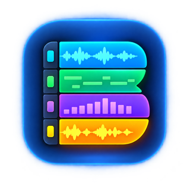

<p align="center">
  
</p>

<h1 align="center">Beatlayer</h1>

<p align="center">An open-source, clean-room reimplementation of Ableton Live, rebuilt in pure Rust. If you know Ableton, you know Beatlayer.</p>

Beatlayer is an open-source digital audio workstation with the workflow of Ableton Live 12: Session and Arrangement views, warping, racks, and a full set of instruments and effects. It's written in Rust and runs natively on macOS (Apple Silicon), Windows, and Linux.

Beatlayer is in early development: the playback core (Phase 1 of 10) is being built.

## Documents

The roadmap, the architecture, the build plan, and the parity plan with Ableton Live 12 will be published here before the first public release. How Beatlayer learns from Live without using its code or content is in [CONTRIBUTING.md](CONTRIBUTING.md#building-without-abletons-code).

## Develop

1. Install Rust with [rustup](https://rustup.rs). The repo pins the toolchain, so rustup fetches the right version on first build.
1. Install cargo-deny, which checks dependency licences and advisories:

   ```sh
   cargo install --locked cargo-deny
   ```

1. Run every check: format, clippy, tests, crate layering, and the dependency policy.

   ```sh
   cargo xtask check
   ```

1. To build this platform's package, install cargo-packager once, then package:

   ```sh
   cargo install --locked cargo-packager@0.11.8
   cargo xtask package
   ```

   The packages land in `target/packages`: `Beatlayer.app` and a DMG on macOS, an MSI on Windows, and an AppImage and a tarball on Linux. They're unsigned unless the signing variables in `.github/workflows/nightly.yml` are set. The task then starts each packaged binary with `--version` to check it.

Read [CONTRIBUTING.md](CONTRIBUTING.md) and [AGENTS.md](AGENTS.md) before contributing. Every contribution follows the [clean-room rules](CONTRIBUTING.md#building-without-abletons-code).

## Licence

GPL-3.0-or-later ([LICENSE](LICENSE)). Contributions are made under the Developer Certificate of Origin.

Ableton, Ableton Live, and Push are trademarks of Ableton AG, and Max is a trademark of Cycling '74. Beatlayer isn't affiliated with or endorsed by either.
